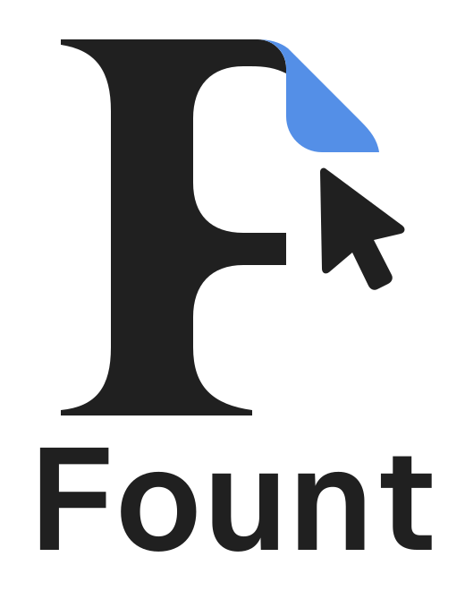
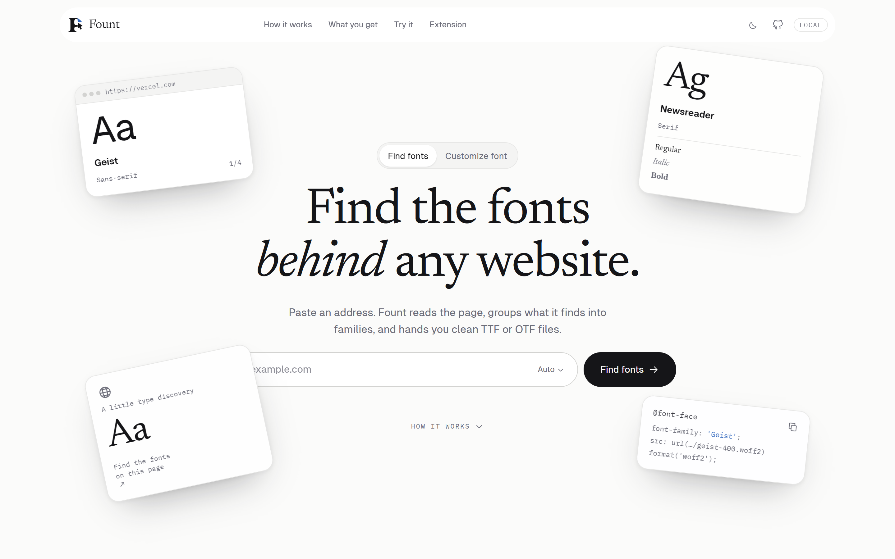
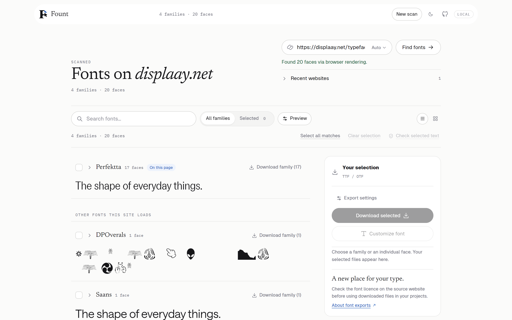
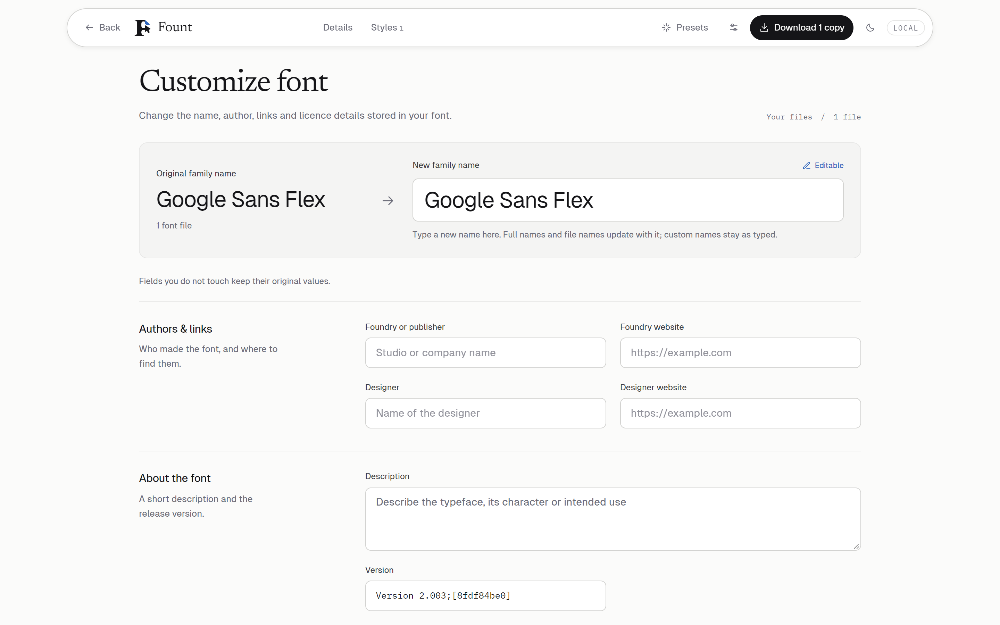
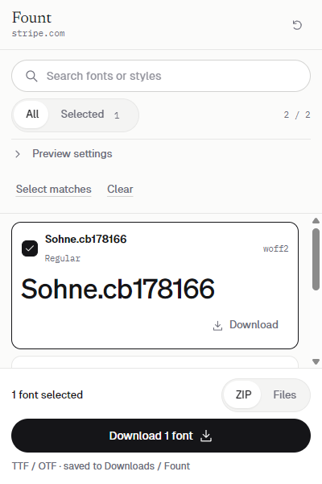
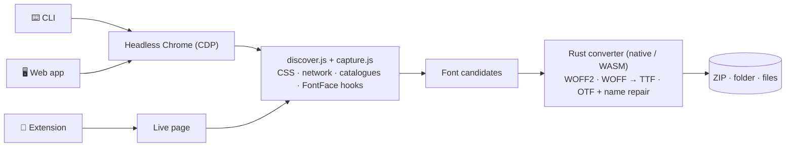

<div align="center">

<a href="https://github.com/Piwqust/font-grabber">
  <picture>
    <source media="(prefers-color-scheme: dark)" srcset="docs/readme/logo-dark.svg">
    
  </picture>
</a>

### Find the fonts behind any website.

Fount reads a page, groups every face it finds into families, and hands you clean&nbsp;**TTF**&nbsp;/&nbsp;**OTF** files,
with names you can rewrite before they're saved.

[](https://github.com/Piwqust/font-grabber/releases/latest)
[](https://github.com/Piwqust/font-grabber/releases)
[](LICENSE)


[**Download**](#-download) · [Quick start](#-quick-start) · [Features](#-features) · [How it works](#-how-it-works) · [Build from source](#-build-from-source) · [FAQ](#-faq)

<br>

<picture>
  <source media="(prefers-color-scheme: dark)" srcset="docs/readme/landing-dark.png">
  
</picture>

</div>

<br>

Foundry sites, type testers and single-page apps hide their fonts in CSS, in JavaScript, behind
extensionless URLs and inside Web Workers. Fount finds them by running **one discovery engine in three
places**, then converts `WOFF2` / `WOFF` back to installable sfnt on your own machine: name table repaired,
variable axes kept.

<table>
<tr>
<td width="33%" valign="top">

**🖥️ Local web app**<br>
<sub>Recommended</sub>

A single binary serves the full interface on `127.0.0.1`: live specimens, family grouping, a metadata
editor, ZIP or save-to-folder.

</td>
<td width="33%" valign="top">

**🧩 Chrome extension**<br>
<sub>No install beyond the browser</sub>

Grabs fonts from the tab you're on and converts them **inside the browser** with the same Rust code
compiled to WebAssembly.

</td>
<td width="33%" valign="top">

**⌨️ CLI**<br>
<sub>Scriptable</sub>

`grab` and `scan` for terminals and pipelines, with `--json` output and name overrides for every
saved face.

</td>
</tr>
</table>

## 📦 Download

Grab the build for your platform from the [**latest release**](https://github.com/Piwqust/font-grabber/releases/latest):

| Platform | File | What's inside |
| --- | --- | --- |
| **Windows** x64 | [`font-grabber-windows-x64.zip`](https://github.com/Piwqust/font-grabber/releases/latest/download/font-grabber-windows-x64.zip) | `font-grabber.exe` plus one-click launchers for the web app and the CLI |
| **Linux** x64 (glibc 2.36+) | [`font-grabber-linux-x64.tar.gz`](https://github.com/Piwqust/font-grabber/releases/latest/download/font-grabber-linux-x64.tar.gz) | `font-grabber` binary |
| **Chrome / Edge** | [`fount-chrome-extension.zip`](https://github.com/Piwqust/font-grabber/releases/latest/download/fount-chrome-extension.zip) | Unpacked Manifest V3 extension, ready to load |

Every release also ships `SHA256SUMS.txt`, so you can check what you downloaded.

> [!NOTE]
> The web app and the CLI use your installed **Chrome or Chromium** for dynamic discovery. Without it,
> Fount falls back to static scanning, which still finds every `@font-face` declared in HTML and CSS.

## 🚀 Quick start

<details open>
<summary><b>Web app</b></summary>

<br>

**Windows:** unzip the release and double-click **`Fount Web.cmd`**. Your browser opens at
`http://127.0.0.1:8787`.

**Linux:**

```bash
tar -xzf font-grabber-linux-x64.tar.gz
./font-grabber serve          # http://127.0.0.1:8787
```

Paste an address, press **Find fonts**, tick the families you want and download a ZIP or save them
straight to a folder.

</details>

<details>
<summary><b>Chrome extension</b></summary>

<br>

1. Unzip `fount-chrome-extension.zip`.
2. Open `chrome://extensions` and turn on **Developer mode**.
3. Click **Load unpacked** and choose the unzipped folder.
4. Open any site and click the **Fount** icon. Reload type-tester pages once after installing, so
   fonts fetched at page load are caught too.

More detail in [extension/README.md](extension/README.md).

</details>

<details>
<summary><b>Command line</b></summary>

<br>

```bash
font-grabber grab https://example.com                   # discover → pick → convert → save
font-grabber grab https://example.com --all -o ./out    # everything, no prompts
font-grabber grab https://displaay.net/typeface/perfektta --all   # a full variable family
font-grabber grab https://example.com --all --family "My Sans"    # rename while saving
font-grabber scan https://example.com --json            # discovery only, machine-readable
```

```text
$ font-grabber grab https://displaay.net/typeface/perfektta --all
✓ Found 22 faces (browser)
✓ Saved 22 fonts → ./fonts/displaay.net
  Perfektta-Variable-400.ttf   (variable · wght 100–900, slnt)
  Perfektta-Bold-700.ttf   Perfektta-Bold-Italic-700.ttf   …
```

</details>

## ✨ Features

<table>
<tr>
<td width="50%" valign="top">

#### Finds what others miss
`@font-face` in CSS, fonts loaded at runtime, extensionless API endpoints, Web Worker fetches and
JavaScript-injected `FontFace` objects.

</td>
<td width="50%" valign="top">

#### Whole families, not fragments
Reads a foundry's own catalogue to list every weight, every italic and the variable master up front,
then joins split faces into one family.

</td>
</tr>
<tr>
<td valign="top">

#### Faithful conversion
`WOFF2` (Brotli) and `WOFF` (zlib) to clean sfnt with checksums rebuilt. Variable tables (`fvar`,
`gvar`) are preserved. Output is byte-identical across the CLI, web app and extension.

</td>
<td valign="top">

#### Metadata editor
Rename a family and its full names, PostScript names and file names follow. Edit author, licence,
copyright, version, description and URLs, with presets and per-face overrides. Works on scanned fonts
or on your own `TTF` / `OTF` / `WOFF` / `WOFF2` files.

</td>
</tr>
<tr>
<td valign="top">

#### Live specimens
Every face is rendered in its real typeface with your own sample text, size and layout. Fonts used on
the page itself are marked **On this page**.

</td>
<td valign="top">

#### Local by default
Scanning and conversion run on your machine. Delivery as a ZIP, into a folder of your choice, or as
single files. Light and dark themes included.

</td>
</tr>
</table>

<table>
<tr>
<td width="58%" valign="top">

<picture>
  <source media="(prefers-color-scheme: dark)" srcset="docs/readme/catalog-dark.png">
  
</picture>
<p align="center"><sub><b>Catalogue</b>: families, faces and live previews after a scan</sub></p>

</td>
<td width="42%" valign="top">

<picture>
  <source media="(prefers-color-scheme: dark)" srcset="docs/readme/metadata-dark.png">
  
</picture>
<p align="center"><sub><b>Customize font</b>: rewrite the name table before saving</sub></p>

<p align="center"></p>
<p align="center"><sub><b>Extension</b>: converts in the browser</sub></p>

</td>
</tr>
</table>

## 🧠 How it works

One discovery engine ([`extension/discover.js`](extension/discover.js) + [`capture.js`](extension/capture.js))
runs everywhere. The Rust apps drive it through an embedded headless Chrome over CDP, so there is no
separate WebDriver to install. The extension runs it in the page directly. Candidates then flow through a
single converter written in Rust.



The converter lives in [`core/src/convert`](core/src/convert) and is compiled to `wasm32-unknown-unknown`
for the extension ([`wasm/`](wasm/)) through a tiny hand-written ABI, without `wasm-bindgen`.

### Discovery modes

| Mode | Browser | Catches | Use it for |
| --- | :---: | --- | --- |
| `auto` *(default)* | static **+** headless Chrome, merged | everything; falls back to static when Chrome is missing | most sites |
| `static` | none | `@font-face` in HTML and linked CSS | speed, CI, simple sites |
| `render` | headless Chrome only | dynamic, extensionless and catalogue fonts | type testers, SPAs |

## 🛠️ Build from source

You need **Rust** ([rustup.rs](https://rustup.rs)) and, for dynamic discovery, Chrome or Chromium.

```bash
git clone https://github.com/Piwqust/font-grabber.git
cd font-grabber/core
cargo build --release            # → core/target/release/font-grabber
cargo test --release             # engine tests
```

<details>
<summary><b>Rebuild the web interface</b> (Preact + esbuild, Node 18+)</summary>

<br>

The built bundle is committed, so this is only needed after editing `core/src/web/src`.

```bash
npm install
npm run build:ui                 # or: npm run dev:ui  (watch mode)
```

</details>

<details>
<summary><b>Rebuild the extension's WASM converter</b></summary>

<br>

```bash
rustup target add wasm32-unknown-unknown
cargo build --manifest-path wasm/Cargo.toml --target wasm32-unknown-unknown --release
cp wasm/target/wasm32-unknown-unknown/release/font_convert_wasm.wasm extension/convert.wasm
```

On Windows, `scripts\build-extension.cmd` does all three steps.

</details>

<details>
<summary><b>Run a private hosted instance</b></summary>

<br>

`font-grabber serve --hosted` turns the web app into a locked-down personal service: an in-app password
gate backed by an Argon2id hash, HTTP-only session cookies, ZIP-only delivery and blocked private-network
fetches. It is meant to sit behind Caddy, never on the open internet by itself. Start with the
[deployment runbook](deploy/README.md) and the [authentication contract](docs/HOSTED-API.md);
`font-grabber password-hash` creates the secret.

</details>

<details>
<summary><b>Repository layout</b></summary>

<br>

```text
.
├── core/         Rust crate: CLI, local web server and the engine
│   └── src/      app · cli · convert · discovery · domain · fetch · output · support · web
├── wasm/         The converter compiled to WebAssembly for the extension
├── extension/    Chrome MV3 extension (popup, shared discover.js, convert.wasm)
├── deploy/       Docker, Caddy and systemd files for the hosted edition
├── scripts/      Build, launch and QA helpers
└── docs/         Design notes, contracts and screenshots
```

</details>

## ❓ FAQ

<details>
<summary><b>Which formats go in and out?</b></summary>

<br>

In: `WOFF2`, `WOFF`, `TTF`, `OTF`, including fonts served without a file extension. Out: `TTF` for
TrueType outlines and `OTF` for CFF outlines, chosen from the font itself.

</details>

<details>
<summary><b>Are variable fonts kept variable?</b></summary>

<br>

Yes. `fvar`, `gvar` and the other variation tables pass through untouched, so a variable master stays
one file with all of its axes.

</details>

<details>
<summary><b>Does anything get uploaded?</b></summary>

<br>

No. The local web app, the CLI and the extension fetch fonts from the site you point them at and convert
them on your computer. Only a hosted instance you deploy yourself runs on a server.

</details>

<details>
<summary><b>Dynamic discovery doesn't start or hangs</b></summary>

<br>

Fount looks for an installed Chrome or Chromium. To use a specific browser build, point Fount at it:

```bash
CHROME=/path/to/chrome font-grabber serve
```

`--mode static` skips the browser entirely.

</details>

> [!IMPORTANT]
> Fonts are software with licences. Fount is meant for inspecting, testing and working with type you are
> allowed to use: your own fonts, open-licence families, or fonts you have bought. Check the licence on the
> foundry's site before using a downloaded file in a project.

## 🤝 Contributing

Issues and pull requests are welcome. Before opening a PR, run `cargo test --release` in `core/` and, if
you touched the interface, `npm run build:ui`. Design and architecture notes live in [`docs/`](docs/), for
example [UI architecture](docs/UI-ARCHITECTURE.md), [the metadata editor](docs/METADATA-EDITOR.md) and
[family workflow](docs/FAMILY-WORKFLOW.md).

## 📄 License

[ISC](LICENSE) © Piwqust

<div align="center">
<br>
<sub>Made for people who notice the type first.</sub>
</div>
